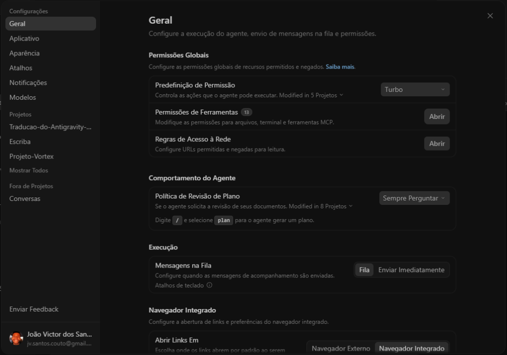
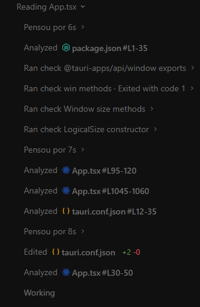
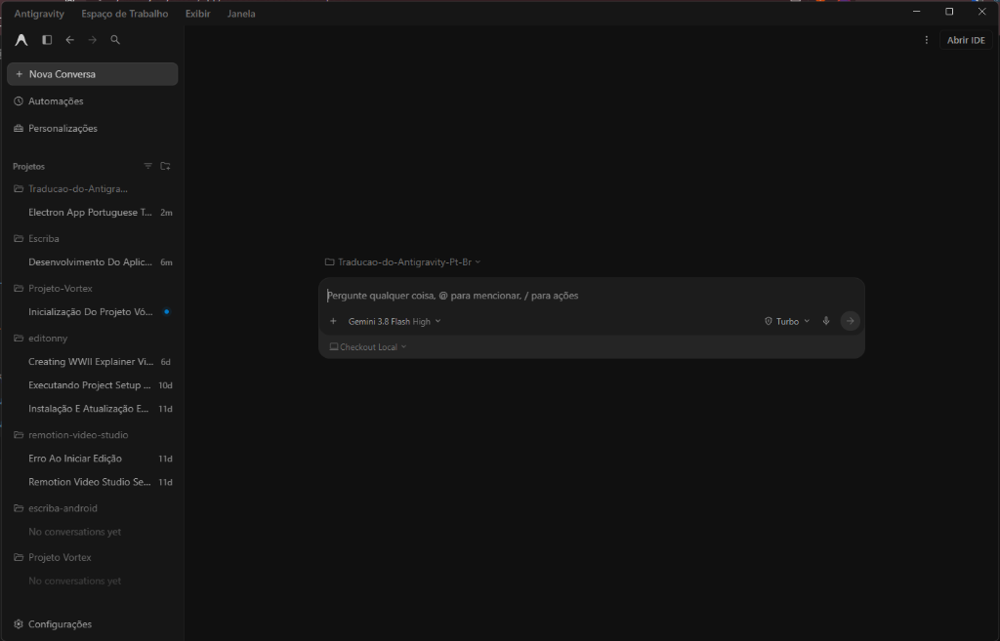
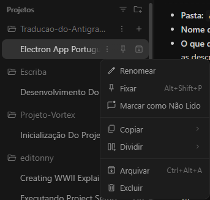

<div align="center">

# 🇧🇷 Tradução do Google Antigravity para Português do Brasil (pt-BR)

**Sistema autônomo, nativo e de alta fidelidade para tradução completa da interface e do fluxo cognitivo do Google Antigravity.**

<p align="center">
  <a href="https://github.com/joaovictorcouto/Traducao-do-Antigravity-Pt-Br/releases/latest">
    
  </a>
  <a href="LICENSE">
    
  </a>
  
  
  
</p>

[Instalação Rápida](#-instalação-rápida) •
[Destaques](#-destaques-principais) •
[Screenshots](#-demonstração-visual) •
[Launcher Nativo](#-launcher-independente-rust) •
[Rollback](#-desinstalação-e-rollback) •
[Estrutura](#-estrutura-do-projeto) •
[Releases](https://github.com/joaovictorcouto/Traducao-do-Antigravity-Pt-Br/releases)

---

</div>

## 📖 Visão Geral

Este projeto oferece uma camada de **tradução transparente em nível de aplicativo** para o **Google Antigravity**, convertendo toda a experiência de usuário para o **Português do Brasil (pt-BR)**. 

Diferente de extensões superficiais de navegador, o sistema opera por meio de uma combinação de:
1. **Substituição direta nos scripts estáticos compilados** do Electron (`menu.js`, `main.js`, `updater.js`, `tray.js`, `ipcHandlers.js`).
2. **Injetor de runtime reativo em tempo de execução** (`runtime.js`), baseado em `MutationObserver` profundo com travessia recursiva de nós de texto puro (`Node.TEXT_NODE`), suporte a Shadow DOM e portais flutuantes (`<div id="portal-root">`, popovers, modais).
3. **Instalador executável autônomo** (`Instalador-Antigravity-ptBR.exe`) e **Launcher oficial em Rust** (`Antigravity-ptbr.exe`) com o ícone oficial embutido no cabeçalho PE.

---

## ✨ Destaques Principais

- **Tradução Completa dos Painéis de Configurações:** Tradução minuciosa das seções *Geral*, *Modelos & Uso*, *Chaves de API*, *Atalhos de Teclado*, *Armazenamento*, *Telemetria* e *Aplicativo* (incluindo explicações de permissões globais, limites de cota e temas visuais).
- **Linha do Tempo e Pensamento da IA em Tempo Real:** Converte dinamicamente termos operacionais e logs contextuais do agente (`Pensou por 6s`, `Analisou package.json`, `Executou comando · Finalizado com código 0`, `Editou`, `Criou`, `Lendo`, `Trabalhando...`).
- **Preservação Técnica Rigorosa:** Nomes de marcas (`Antigravity`, `Google AI Pro`, `Gemini`, `Claude`), comandos shell, caminhos de arquivo, variáveis de ambiente, tags de template (`<code>`, `<kbd>`) e identificadores de API são estritamente preservados para garantir 100% de estabilidade técnica.
- **Suporte a Componentes Assíncronos e Portais:** Observa e traduz instantaneamente elementos montados sob demanda (menus de contexto de três pontos, dropdowns de modelos, caixas de diálogo modais e dicas de ferramentas).
- **Instalador Autônomo de 1 Clique:** Não requer instalação prévia de Node.js, Python, Git ou compiladores na máquina do usuário final.
- **Rollback Instantâneo e Seguro:** Backup automático do `app.asar.bak` antes de qualquer alteração, permitindo restauração instantânea para o inglês com integridade absoluta.

---

## 🖼️ Demonstração Visual

| Painel de Configurações | Linha do Tempo e Ações do Agente |
| :---: | :---: |
|  |  |

| Chat e Sugestões | Menus de Contexto e Projetos |
| :---: | :---: |
|  |  |

---

## 🚀 Instalação Rápida

### Opção 1: Instalador Executável (Recomendado para Usuários)

A maneira mais rápida e prática. Não requer terminal nem dependências externas:

1. Acesse a página de [Releases](https://github.com/joaovictorcouto/Traducao-do-Antigravity-Pt-Br/releases/latest) e baixe o `Instalador-Antigravity-ptBR.exe`.
2. Dê dois cliques no executável.
3. Clique em **Sim** na tela de confirmação.
4. O instalador detectará a instalação do Google Antigravity, aplicará o patch no `app.asar`, configurará o launcher com o ícone oficial e criará os atalhos na sua **Área de Trabalho** e **Menu Iniciar**.

---

### Opção 2: Para Desenvolvedores (via Node.js e Terminal)

Caso você prefira clonar o código-fonte, inspecionar o dicionário e compilar localmente:

#### Pré-requisitos
- **Windows 10/11**
- **Google Antigravity** instalado
- **Node.js** (v18 ou superior)
- **Rust / Cargo** *(opcional, apenas se desejar recompilar os binários PE)*

#### Passo a Passo
```bash
# 1. Clonar o repositório
git clone https://github.com/joaovictorcouto/Traducao-do-Antigravity-Pt-Br.git
cd Traducao-do-Antigravity-Pt-Br

# 2. Instalar dependências
npm install

# 3. Aplicar o patch de tradução
npm run patch

# 4. (Opcional) Compilar o Launcher e criar atalhos com ícone oficial
npm run build:launcher
npm run create-shortcuts
```

---

## ⚡ Launcher Independente (Rust)

O projeto inclui o binário nativo `Antigravity-ptbr.exe`, compilado em Rust com perfil otimizado para Windows:

- **Ícone Oficial Embutido:** O executável contém o recurso de ícone (`app.ico`) em 7 camadas de resolução (de 16x16 até 256x256), exibindo a marca original no Explorador de Arquivos, Barra de Tarefas e Menu Iniciar.
- **Verificação Ativa de Integridade:** Antes de abrir o aplicativo, o launcher verifica se o pacote `app.asar` está devidamente traduzido. Se o Google Antigravity for atualizado pelo instalador oficial e sobrescrever o arquivo, o launcher detecta a ausência da assinatura e reaplica a tradução silenciosamente.
- **Consumo Zero de Recursos:** Após repassar os argumentos de linha de comando para o processo do Antigravity, o launcher finaliza sua própria execução, consumindo **0 MB de memória RAM** durante a utilização do app.

---

## 🔄 Desinstalação e Rollback

Para desfazer a tradução e restaurar o Google Antigravity exatamente ao estado original em inglês:

```bash
npm run restore
```

O comando substitui o arquivo modificado pelo backup original `app.asar.bak` e valida a remoção da injeção. Se preferir restaurar manualmente, basta renomear:
`%LOCALAPPDATA%\Programs\Antigravity\resources\app.asar.bak`  
de volta para:  
`%LOCALAPPDATA%\Programs\Antigravity\resources\app.asar`.

---

## 📁 Estrutura do Projeto

```text
Traducao-do-Antigravity-Pt-Br/
├── core/
│   ├── patcher.js               # Motor principal de extração, injeção e reempacotamento ASAR
│   ├── source-patcher.js        # Substituições estáticas diretas em arquivos compilados (menu, updater, tray)
│   ├── restore.js               # Mecanismo de rollback e restauração do backup original
│   ├── embedded-assets.js       # Carregador de assets estáticos embutidos para build autônomo
│   └── installer-engine.js      # Motor empacotado para o instalador executável
├── injector/
│   ├── runtime.js               # Motor reativo de tradução em tempo de execução (DOM, regex e observação)
│   └── locales/
│       └── pt-br.json           # Dicionário central de traduções pt-BR
├── launcher/
│   ├── src/main.rs              # Código-fonte do Launcher nativo em Rust
│   ├── Cargo.toml               # Manifesto e dependências de compilação Rust
│   ├── build.rs                 # Script de build para embutir ícone Windows via winres
│   ├── app.ico                  # Ícone oficial em múltiplas resoluções
│   ├── extract-icon.js          # Utilitário de extração do ícone do binário PE oficial
│   └── create-shortcuts.js      # Gerador de atalhos Windows (.lnk) com notificação de cache de ícone
├── installer/
│   ├── src/main.rs              # Código-fonte do Instalador autônomo em Rust (Win32 GUI)
│   ├── Cargo.toml               # Manifesto de compilação do instalador
│   └── build.rs                 # Vinculação de recursos e ícone do instalador
├── test/
│   ├── test-system.js           # Suíte de 240 testes automatizados de dicionário, regex e integridade
│   └── test-mock.js             # Teste de ciclo de vida completo (patch e rollback) em mock ASAR
├── assets/                      # Imagens de preview e capturas de tela da aplicação traduzida
├── Antigravity-ptbr.exe         # Executável compilado do Launcher oficial
├── Instalador-Antigravity-ptBR.exe # Instalador executável autônomo de 1 clique
└── package.json                 # Scripts NPM e metadados do projeto
```

---

## 🛠️ Comandos Disponíveis

| Comando | Descrição |
|---|---|
| `npm run patch` | Aplica o patch pt-BR no Antigravity instalado no sistema. |
| `npm run patch:force` | Força a reextração, patch completo e injeção do dicionário atualizado. |
| `npm run patch:check` | Verifica o estado atual de integridade e patch do `app.asar`. |
| `npm run restore` | Restaura o `app.asar` original a partir do backup `.bak`. |
| `npm run build:launcher` | Compila o launcher nativo em Rust (`Antigravity-ptbr.exe`). |
| `npm run build:installer` | Gera o executável autônomo `Instalador-Antigravity-ptBR.exe`. |
| `npm run create-shortcuts` | Cria ou atualiza os atalhos na Área de Trabalho e Menu Iniciar. |
| `npm run setup` | Executa o ciclo completo: patch, build do launcher e criação de atalhos. |
| `npm test` | Executa todos os 240 testes unitários e de integração com mock do Electron. |

---

## 🧪 Testes Automatizados

O repositório possui cobertura abrangente de testes para assegurar que nenhum termo técnico de código seja corrompido:

```bash
npm test
```

A suíte valida:
1. Mais de 500 entradas do dicionário `pt-br.json`.
2. Integridade dos padrões de regex dinâmica (tempos de execução, pensamento, códigos de saída e contadores de arquivos).
3. Regras estritas de preservação sintática nos módulos estáticos compilados.
4. Cabeçalhos PE (`MZ`) dos executáveis gerados em Rust.
5. Camadas de resolução do ícone `.ico`.
6. Ciclo completo de empacotamento e restauração com mock real de pacote ASAR do Electron.

---

## 🤝 Contribuições

Contribuições da comunidade são muito bem-vindas!
1. Faça um Fork do projeto.
2. Crie uma branch para sua modificação (`git checkout -b feature/novo-termo`).
3. Adicione as melhorias ou termos pendentes em `injector/locales/pt-br.json`.
4. Execute `npm test` para garantir que todos os testes passem.
5. Faça o commit (`git commit -m "feat: adiciona tradução do menu X"`).
6. Abra um Pull Request.

---

## 📄 Licença

Este projeto é disponibilizado sob a licença **MIT**. Veja o arquivo [LICENSE](LICENSE) para mais detalhes.

Google Antigravity é uma marca registrada da Google LLC. Este projeto é uma iniciativa comunitária de código aberto para acessibilidade e localização, sem vínculo oficial com a Google LLC.
